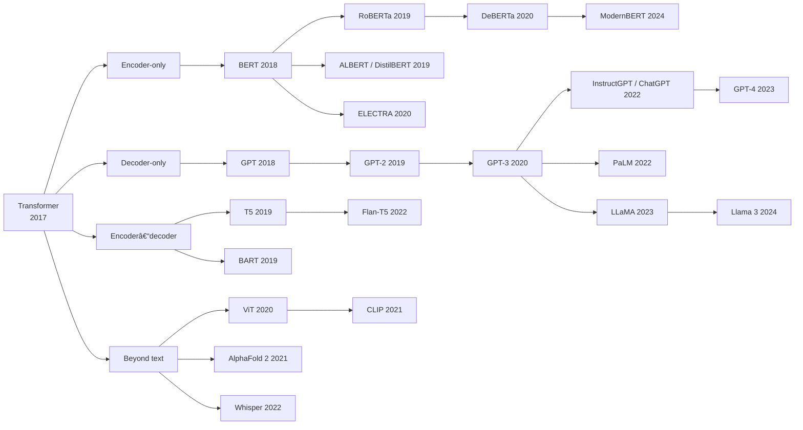

# Awesome Transformer 

> A curated list of must-read papers, blogs, courses, and API tools for the **Transformer** architecture, from "Attention Is All You Need" (2017) to today's large language models.

The Transformer replaced recurrence with attention, and in doing so became the foundation of modern AI: BERT, GPT, T5, LLaMA, Claude, Gemini, Vision Transformers, AlphaFold, and more. This list collects the papers worth reading, the best explanations of them, and the tools for building with them.

**Legend:** � = must-read · 🧑�🎓 = beginner-friendly · 🛠� = has code

Last reviewed: October 2026. Model and API landscapes change quickly; pull requests are welcome.

---

## Contents

- [Start Here: A Reading Path](#start-here-a-reading-path)
- [The Transformer Family Tree](#the-transformer-family-tree)
- [Papers](#papers)
  - [Foundations Before the Transformer](#foundations-before-the-transformer)
  - [The Original Transformer](#the-original-transformer)
  - [Architecture Refinements](#architecture-refinements)
  - [Pretrained Encoders (BERT Family)](#pretrained-encoders-bert-family)
  - [Encoder–Decoder Models](#encoderdecoder-models)
  - [Decoder-Only Models and LLMs](#decoder-only-models-and-llms)
  - [Scaling Laws and Emergence](#scaling-laws-and-emergence)
  - [Mixture of Experts](#mixture-of-experts)
  - [Efficient and Long-Context Attention](#efficient-and-long-context-attention)
  - [Alignment and Instruction Tuning](#alignment-and-instruction-tuning)
  - [Prompting, Reasoning, Retrieval, and Agents](#prompting-reasoning-retrieval-and-agents)
  - [Parameter-Efficient Fine-Tuning and Quantization](#parameter-efficient-fine-tuning-and-quantization)
  - [Vision, Speech, and Multimodal Transformers](#vision-speech-and-multimodal-transformers)
  - [Transformers in Science and Robotics](#transformers-in-science-and-robotics)
  - [Interpretability](#interpretability)
  - [Beyond Attention: Alternative Architectures](#beyond-attention-alternative-architectures)
  - [Benchmarks and Datasets](#benchmarks-and-datasets)
  - [Surveys](#surveys)
  - [Risks, Costs, and Society](#risks-costs-and-society)
- [Blogs and Visual Explanations](#blogs-and-visual-explanations)
- [Videos and Courses](#videos-and-courses)
- [Books](#books)
- [Code: Learn by Building](#code-learn-by-building)
- [API Tools and Libraries](#api-tools-and-libraries)
  - [Core Libraries](#core-libraries)
  - [Tokenizers](#tokenizers)
  - [Training and Fine-Tuning](#training-and-fine-tuning)
  - [Inference and Serving](#inference-and-serving)
  - [Hosted Model APIs](#hosted-model-apis)
  - [Application Frameworks](#application-frameworks)
  - [Evaluation](#evaluation)
  - [Visualization and Interpretability Tools](#visualization-and-interpretability-tools)
- [History and Context](#history-and-context)
- [Contributing](#contributing)

---

## Start Here: A Reading Path

New to Transformers? Read these in order. Each step builds on the one before.

| Step | Read | Why |
|:---:|---|---|
| 1 | 🧑�🎓 [Understanding LSTM Networks](https://colah.github.io/posts/2015-08-Understanding-LSTMs/) (Olah, 2015) | The problem the Transformer solved |
| 2 | 🧑�🎓 [Attention and Augmented RNNs](https://distill.pub/2016/augmented-rnns/) (Olah & Carter, 2016) | Where attention came from |
| 3 | 🧑�🎓 [The Illustrated Transformer](https://jalammar.github.io/illustrated-transformer/) (Alammar, 2018) | The architecture, visually |
| 4 | â­� [Attention Is All You Need](https://arxiv.org/abs/1706.03762) (Vaswani et al., 2017) | The original paper |
| 5 | 🛠� [The Annotated Transformer](https://nlp.seas.harvard.edu/annotated-transformer/) (Harvard NLP) | The paper, line by line in PyTorch |
| 6 | 🧑�🎓 [Let's build GPT: from scratch, in code](https://www.youtube.com/watch?v=kCc8FmEb1nY) (Karpathy, 2023) | Build one yourself |
| 7 | â­� [BERT](https://arxiv.org/abs/1810.04805) and â­� [GPT-3](https://arxiv.org/abs/2005.14165) | The two branches that changed NLP |
| 8 | â­� [Scaling Laws for Neural Language Models](https://arxiv.org/abs/2001.08361) | Why bigger kept getting better |
| 9 | â­� [InstructGPT](https://arxiv.org/abs/2203.02155) | How a language model becomes an assistant |

---

## The Transformer Family Tree

| Family | Reads text | Pretraining objective | Best for | Examples |
|---|---|---|---|---|
| **Encoder-only** | All at once, both directions | Fill in masked words | Classification, search, embeddings | BERT, RoBERTa, DeBERTa, ModernBERT |
| **Decoder-only** | Left to right | Predict the next token | Generation, chat, code, agents | GPT series, LLaMA, Claude, Gemini, Mistral |
| **Encoder–decoder** | Encoder reads, decoder writes | Reconstruct corrupted spans | Translation, summarization | Original Transformer, T5, BART |

---

## Papers

### Foundations Before the Transformer

The ideas the Transformer was built from.

| Year | Paper | Why it matters |
|:---:|---|---|
| 1997 | � [Long Short-Term Memory](https://www.bioinf.jku.at/publications/older/2604.pdf) — Hochreiter & Schmidhuber | The dominant sequence model for two decades |
| 2003 | [A Neural Probabilistic Language Model](https://www.jmlr.org/papers/volume3/bengio03a/bengio03a.pdf) — Bengio et al. | First neural language model with learned word vectors |
| 2013 | � [Efficient Estimation of Word Representations in Vector Space (Word2Vec)](https://arxiv.org/abs/1301.3781) — Mikolov et al. | King − Man + Woman ≈ Queen |
| 2014 | [GloVe: Global Vectors for Word Representation](https://nlp.stanford.edu/pubs/glove.pdf) — Pennington et al. | Word vectors from global co-occurrence |
| 2014 | � [Sequence to Sequence Learning with Neural Networks](https://arxiv.org/abs/1409.3215) — Sutskever et al. | The encoder–decoder template |
| 2014 | [Learning Phrase Representations using RNN Encoder–Decoder (GRU)](https://arxiv.org/abs/1406.1078) — Cho et al. | GRU and encoder–decoder translation |
| 2014 | � [Neural Machine Translation by Jointly Learning to Align and Translate](https://arxiv.org/abs/1409.0473) — Bahdanau et al. | **The invention of attention** |
| 2014 | [Neural Turing Machines](https://arxiv.org/abs/1410.5401) — Graves et al. | Differentiable memory with attention-based addressing |
| 2015 | [Effective Approaches to Attention-based NMT](https://arxiv.org/abs/1508.04025) — Luong et al. | Simpler, faster dot-product attention |
| 2015 | [Neural Machine Translation of Rare Words with Subword Units (BPE)](https://arxiv.org/abs/1508.07909) — Sennrich et al. | Byte-pair encoding tokenization |
| 2015 | [Deep Residual Learning (ResNet)](https://arxiv.org/abs/1512.03385) — He et al. | Residual connections, used in every Transformer layer |
| 2016 | [Layer Normalization](https://arxiv.org/abs/1607.06450) — Ba et al. | The "Norm" in "Add & Norm" |
| 2016 | [A Decomposable Attention Model for NLI](https://arxiv.org/abs/1606.01933) — Parikh et al. | Attention without recurrence, a direct precursor |
| 2017 | [A Structured Self-Attentive Sentence Embedding](https://arxiv.org/abs/1703.03130) — Lin et al. | Early self-attention |

### The Original Transformer

| Year | Paper | Why it matters |
|:---:|---|---|
| 2017 | � [**Attention Is All You Need**](https://arxiv.org/abs/1706.03762) — Vaswani, Shazeer, Parmar, Uszkoreit, Jones, Gomez, Kaiser, Polosukhin | Self-attention, multi-head attention, positional encoding, fully parallel training. 28.4 BLEU on WMT14 En–De. The paper that started it all. [Code: Tensor2Tensor](https://github.com/tensorflow/tensor2tensor) 🛠� |
| 2017 | [Transformer: A Novel Neural Network Architecture for Language Understanding](https://research.google/blog/transformer-a-novel-neural-network-architecture-for-language-understanding/) — Google Research Blog | The authors' own accessible announcement |

### Architecture Refinements

The small changes that every modern Transformer uses.

| Year | Paper | Contribution |
|:---:|---|---|
| 2018 | [Self-Attention with Relative Position Representations](https://arxiv.org/abs/1803.02155) — Shaw et al. | Relative positions instead of absolute |
| 2018 | [Universal Transformers](https://arxiv.org/abs/1807.03819) — Dehghani et al. | Weight-shared, recurrent-in-depth Transformer |
| 2019 | [Transformer-XL](https://arxiv.org/abs/1901.02860) — Dai et al. | Segment-level recurrence for longer context |
| 2019 | [Fast Transformer Decoding: One Write-Head is All You Need (MQA)](https://arxiv.org/abs/1911.02150) — Shazeer | Multi-query attention for fast inference |
| 2019 | [Root Mean Square Layer Normalization (RMSNorm)](https://arxiv.org/abs/1910.07467) — Zhang & Sennrich | Cheaper normalization used in LLaMA and others |
| 2020 | [On Layer Normalization in the Transformer Architecture (Pre-LN)](https://arxiv.org/abs/2002.04745) — Xiong et al. | Why modern models normalize *before* each sublayer |
| 2020 | � [GLU Variants Improve Transformer (SwiGLU)](https://arxiv.org/abs/2002.05202) — Shazeer | The feed-forward layer in most current LLMs |
| 2021 | � [RoFormer: Rotary Position Embedding (RoPE)](https://arxiv.org/abs/2104.09864) — Su et al. | The dominant positional scheme in today's LLMs |
| 2021 | [Train Short, Test Long: Attention with Linear Biases (ALiBi)](https://arxiv.org/abs/2108.12409) — Press et al. | Length extrapolation without position embeddings |
| 2023 | [GQA: Training Generalized Multi-Query Transformer Models](https://arxiv.org/abs/2305.13245) — Ainslie et al. | Grouped-query attention, the MQA/MHA middle ground |

### Pretrained Encoders (BERT Family)

| Year | Paper | Contribution |
|:---:|---|---|
| 2018 | [Deep Contextualized Word Representations (ELMo)](https://arxiv.org/abs/1802.05365) — Peters et al. | Contextual embeddings from bidirectional LSTMs |
| 2018 | [Universal Language Model Fine-tuning (ULMFiT)](https://arxiv.org/abs/1801.06146) — Howard & Ruder | Pretrain, then fine-tune |
| 2018 | � [**BERT: Pre-training of Deep Bidirectional Transformers**](https://arxiv.org/abs/1810.04805) — Devlin et al. | Masked language modeling; state of the art on 11 tasks. [Code](https://github.com/google-research/bert) 🛠� |
| 2019 | [XLNet](https://arxiv.org/abs/1906.08237) — Yang et al. | Permutation language modeling |
| 2019 | � [RoBERTa: A Robustly Optimized BERT Pretraining Approach](https://arxiv.org/abs/1907.11692) — Liu et al. | Same model, better training recipe |
| 2019 | [SpanBERT](https://arxiv.org/abs/1907.10529) — Joshi et al. | Masking spans instead of tokens |
| 2019 | [ALBERT: A Lite BERT](https://arxiv.org/abs/1909.11942) — Lan et al. | Parameter sharing and factorized embeddings |
| 2019 | [DistilBERT](https://arxiv.org/abs/1910.01108) — Sanh et al. | Knowledge distillation: 40% smaller, 60% faster |
| 2019 | [Sentence-BERT](https://arxiv.org/abs/1908.10084) — Reimers & Gurevych | Sentence embeddings for semantic search |
| 2019 | [XLM-R: Unsupervised Cross-lingual Representation Learning at Scale](https://arxiv.org/abs/1911.02116) — Conneau et al. | Multilingual encoder for 100 languages |
| 2020 | � [ELECTRA: Pre-training Text Encoders as Discriminators](https://arxiv.org/abs/2003.10555) — Clark et al. | Replaced-token detection; far more compute-efficient |
| 2020 | [DeBERTa: Decoding-enhanced BERT with Disentangled Attention](https://arxiv.org/abs/2006.03654) — He et al. | Disentangled content/position attention |
| 2024 | [ModernBERT: Smarter, Better, Faster, Longer](https://arxiv.org/abs/2412.13663) — Warner et al. | Encoder-only design updated with modern techniques; 8K context |

### Encoder–Decoder Models

| Year | Paper | Contribution |
|:---:|---|---|
| 2019 | � [**Exploring the Limits of Transfer Learning with a Unified Text-to-Text Transformer (T5)**](https://arxiv.org/abs/1910.10683) — Raffel et al. | Every task as text-to-text; the C4 dataset; huge systematic study. [Code](https://github.com/google-research/text-to-text-transfer-transformer) 🛠� |
| 2019 | [BART: Denoising Sequence-to-Sequence Pre-training](https://arxiv.org/abs/1910.13461) — Lewis et al. | Denoising autoencoder; strong summarization |
| 2020 | [mT5: A Massively Multilingual Pre-trained Text-to-Text Transformer](https://arxiv.org/abs/2010.11934) — Xue et al. | T5 for 101 languages |
| 2022 | [Scaling Instruction-Finetuned Language Models (Flan-T5)](https://arxiv.org/abs/2210.11416) — Chung et al. | Instruction tuning at scale |

### Decoder-Only Models and LLMs

| Year | Paper | Contribution |
|:---:|---|---|
| 2018 | � [Improving Language Understanding by Generative Pre-Training (GPT)](https://cdn.openai.com/research-covers/language-unsupervised/language_understanding_paper.pdf) — Radford et al. | Generative pretraining with a Transformer decoder |
| 2019 | � [Language Models are Unsupervised Multitask Learners (GPT-2)](https://cdn.openai.com/better-language-models/language_models_are_unsupervised_multitask_learners.pdf) — Radford et al. | 1.5B parameters; zero-shot task ability. [Code](https://github.com/openai/gpt-2) 🛠� |
| 2019 | [Megatron-LM: Training Multi-Billion Parameter Models Using Model Parallelism](https://arxiv.org/abs/1909.08053) — Shoeybi et al. | How to split a Transformer across GPUs |
| 2020 | � [**Language Models are Few-Shot Learners (GPT-3)**](https://arxiv.org/abs/2005.14165) — Brown et al. | 175B parameters; in-context learning |
| 2021 | [Scaling Language Models: Methods, Analysis & Insights (Gopher)](https://arxiv.org/abs/2112.11446) — Rae et al. | 280B-parameter study of what scale improves |
| 2022 | [PaLM: Scaling Language Modeling with Pathways](https://arxiv.org/abs/2204.02311) — Chowdhery et al. | 540B parameters across 6,144 TPU chips |
| 2022 | [OPT: Open Pre-trained Transformer Language Models](https://arxiv.org/abs/2205.01068) — Zhang et al. | Openly released GPT-3-scale model |
| 2022 | [BLOOM: A 176B-Parameter Open-Access Multilingual Language Model](https://arxiv.org/abs/2211.05100) — BigScience | Large open collaborative model |
| 2023 | � [**LLaMA: Open and Efficient Foundation Language Models**](https://arxiv.org/abs/2302.13971) — Touvron et al. | Smaller models, more data; launched the open-weight ecosystem |
| 2023 | [GPT-4 Technical Report](https://arxiv.org/abs/2303.08774) — OpenAI | Multimodal; near-expert exam performance |
| 2023 | [Llama 2: Open Foundation and Fine-Tuned Chat Models](https://arxiv.org/abs/2307.09288) — Touvron et al. | Open weights with a commercial-use license |
| 2023 | [Mistral 7B](https://arxiv.org/abs/2310.06825) — Jiang et al. | Strong small model with sliding-window attention |
| 2023 | [Gemini: A Family of Highly Capable Multimodal Models](https://arxiv.org/abs/2312.11805) — Gemini Team, Google | Natively multimodal |
| 2024 | [The Llama 3 Herd of Models](https://arxiv.org/abs/2407.21783) — Llama Team, Meta | 405B open-weight model; detailed recipe |
| 2024 | [DeepSeek-V3 Technical Report](https://arxiv.org/abs/2412.19437) — DeepSeek-AI | Efficient large MoE model |
| 2024 | [Qwen2.5 Technical Report](https://arxiv.org/abs/2412.15115) — Qwen Team | Widely used open-weight family |

### Scaling Laws and Emergence

| Year | Paper | Contribution |
|:---:|---|---|
| 2020 | � [**Scaling Laws for Neural Language Models**](https://arxiv.org/abs/2001.08361) — Kaplan et al. | Loss falls as a smooth power law in parameters, data, and compute |
| 2022 | � [Training Compute-Optimal Large Language Models (Chinchilla)](https://arxiv.org/abs/2203.15556) — Hoffmann et al. | Most models were undertrained; scale data with parameters |
| 2022 | [Emergent Abilities of Large Language Models](https://arxiv.org/abs/2206.07682) — Wei et al. | Abilities that appear only at scale |
| 2023 | [Are Emergent Abilities of Large Language Models a Mirage?](https://arxiv.org/abs/2304.15004) — Schaeffer et al. | Emergence may partly depend on the metric |

### Mixture of Experts

| Year | Paper | Contribution |
|:---:|---|---|
| 2017 | [Outrageously Large Neural Networks: The Sparsely-Gated MoE Layer](https://arxiv.org/abs/1701.06538) — Shazeer et al. | Conditional computation with expert routing |
| 2020 | [GShard](https://arxiv.org/abs/2006.16668) — Lepikhin et al. | MoE Transformers at 600B parameters |
| 2021 | � [Switch Transformers](https://arxiv.org/abs/2101.03961) — Fedus et al. | Simple top-1 routing to trillion-parameter scale |
| 2024 | [Mixtral of Experts](https://arxiv.org/abs/2401.04088) — Jiang et al. | Open-weight sparse MoE LLM |

### Efficient and Long-Context Attention

Full attention costs O(n²) in sequence length. These papers make it cheaper or longer.

| Year | Paper | Contribution |
|:---:|---|---|
| 2019 | [Generating Long Sequences with Sparse Transformers](https://arxiv.org/abs/1904.10509) — Child et al. | Fixed sparse attention patterns |
| 2020 | [Reformer: The Efficient Transformer](https://arxiv.org/abs/2001.04451) — Kitaev et al. | Locality-sensitive hashing attention |
| 2020 | [Longformer: The Long-Document Transformer](https://arxiv.org/abs/2004.05150) — Beltagy et al. | Sliding-window plus global attention |
| 2020 | [Linformer: Self-Attention with Linear Complexity](https://arxiv.org/abs/2006.04768) — Wang et al. | Low-rank attention |
| 2020 | [Big Bird: Transformers for Longer Sequences](https://arxiv.org/abs/2007.14062) — Zaheer et al. | Random + window + global attention |
| 2020 | [Rethinking Attention with Performers](https://arxiv.org/abs/2009.14794) — Choromanski et al. | Kernel-based linear attention |
| 2022 | � [FlashAttention: Fast and Memory-Efficient Exact Attention](https://arxiv.org/abs/2205.14135) — Dao et al. | IO-aware exact attention; now standard everywhere. [Code](https://github.com/Dao-AILab/flash-attention) 🛠� |
| 2023 | [FlashAttention-2](https://arxiv.org/abs/2307.08691) — Dao | Better parallelism and work partitioning |
| 2023 | � [Efficient Memory Management for LLM Serving with PagedAttention (vLLM)](https://arxiv.org/abs/2309.06180) — Kwon et al. | Paged KV cache for high-throughput serving |
| 2023 | [Fast Inference from Transformers via Speculative Decoding](https://arxiv.org/abs/2211.17192) — Leviathan et al. | Draft-and-verify decoding speedups |
| 2023 | [Ring Attention with Blockwise Transformers for Near-Infinite Context](https://arxiv.org/abs/2310.01889) — Liu et al. | Distributing very long sequences across devices |
| 2023 | [Lost in the Middle: How Language Models Use Long Contexts](https://arxiv.org/abs/2307.03172) — Liu et al. | Long context ≠ reliably used context |

### Alignment and Instruction Tuning

| Year | Paper | Contribution |
|:---:|---|---|
| 2017 | [Deep Reinforcement Learning from Human Preferences](https://arxiv.org/abs/1706.03741) — Christiano et al. | The origin of RLHF |
| 2021 | [Finetuned Language Models Are Zero-Shot Learners (FLAN)](https://arxiv.org/abs/2109.01652) — Wei et al. | Instruction tuning |
| 2022 | � [**Training Language Models to Follow Instructions with Human Feedback (InstructGPT)**](https://arxiv.org/abs/2203.02155) — Ouyang et al. | The recipe behind ChatGPT |
| 2022 | [Constitutional AI: Harmlessness from AI Feedback](https://arxiv.org/abs/2212.08073) — Bai et al. | Alignment with AI feedback guided by written principles |
| 2023 | � [Direct Preference Optimization (DPO)](https://arxiv.org/abs/2305.18290) — Rafailov et al. | Preference tuning without a separate reward model |
| 2025 | [DeepSeek-R1: Incentivizing Reasoning Capability via RL](https://arxiv.org/abs/2501.12948) — DeepSeek-AI | Reinforcement learning for long-form reasoning |

### Prompting, Reasoning, Retrieval, and Agents

| Year | Paper | Contribution |
|:---:|---|---|
| 2020 | � [Retrieval-Augmented Generation for Knowledge-Intensive NLP (RAG)](https://arxiv.org/abs/2005.11401) — Lewis et al. | Combine a retriever with a generator |
| 2022 | � [Chain-of-Thought Prompting Elicits Reasoning](https://arxiv.org/abs/2201.11903) — Wei et al. | "Think step by step" |
| 2022 | [Self-Consistency Improves Chain of Thought Reasoning](https://arxiv.org/abs/2203.11171) — Wang et al. | Sample many reasoning paths, vote |
| 2022 | � [ReAct: Synergizing Reasoning and Acting](https://arxiv.org/abs/2210.03629) — Yao et al. | Interleave reasoning with tool use: the agent pattern |
| 2023 | [Toolformer: Language Models Can Teach Themselves to Use Tools](https://arxiv.org/abs/2302.04761) — Schick et al. | Self-supervised tool use |

### Parameter-Efficient Fine-Tuning and Quantization

| Year | Paper | Contribution |
|:---:|---|---|
| 2019 | [Parameter-Efficient Transfer Learning for NLP (Adapters)](https://arxiv.org/abs/1902.00751) — Houlsby et al. | Small trainable modules inside a frozen model |
| 2021 | [Prefix-Tuning](https://arxiv.org/abs/2101.00190) — Li & Liang | Learn continuous prompts only |
| 2021 | � [LoRA: Low-Rank Adaptation of Large Language Models](https://arxiv.org/abs/2106.09685) — Hu et al. | The standard way to fine-tune LLMs cheaply |
| 2022 | [LLM.int8(): 8-bit Matrix Multiplication for Transformers at Scale](https://arxiv.org/abs/2208.07339) — Dettmers et al. | 8-bit inference without quality loss |
| 2022 | [GPTQ: Accurate Post-Training Quantization](https://arxiv.org/abs/2210.17323) — Frantar et al. | 3–4-bit weight quantization |
| 2023 | � [QLoRA: Efficient Finetuning of Quantized LLMs](https://arxiv.org/abs/2305.14314) — Dettmers et al. | Fine-tune large models on a single GPU |

### Vision, Speech, and Multimodal Transformers

| Year | Paper | Contribution |
|:---:|---|---|
| 2020 | [End-to-End Object Detection with Transformers (DETR)](https://arxiv.org/abs/2005.12872) — Carion et al. | Detection as set prediction |
| 2020 | � [**An Image is Worth 16x16 Words (ViT)**](https://arxiv.org/abs/2010.11929) — Dosovitskiy et al. | Images as sequences of patches |
| 2020 | [wav2vec 2.0](https://arxiv.org/abs/2006.11477) — Baevski et al. | Self-supervised speech Transformers |
| 2020 | [Training Data-Efficient Image Transformers (DeiT)](https://arxiv.org/abs/2012.12877) — Touvron et al. | ViT without huge datasets |
| 2021 | [Swin Transformer](https://arxiv.org/abs/2103.14030) — Liu et al. | Hierarchical shifted-window vision backbone |
| 2021 | � [Learning Transferable Visual Models From Natural Language Supervision (CLIP)](https://arxiv.org/abs/2103.00020) — Radford et al. | Joint image–text embeddings |
| 2021 | [Zero-Shot Text-to-Image Generation (DALL·E)](https://arxiv.org/abs/2102.12092) — Ramesh et al. | Transformer-based image generation |
| 2021 | [Masked Autoencoders Are Scalable Vision Learners (MAE)](https://arxiv.org/abs/2111.06377) — He et al. | BERT-style masking for images |
| 2022 | [Flamingo: a Visual Language Model for Few-Shot Learning](https://arxiv.org/abs/2204.14198) — Alayrac et al. | Interleaved image–text LLM |
| 2022 | � [Robust Speech Recognition via Large-Scale Weak Supervision (Whisper)](https://arxiv.org/abs/2212.04356) — Radford et al. | Encoder–decoder Transformer for speech |
| 2022 | [Scalable Diffusion Models with Transformers (DiT)](https://arxiv.org/abs/2212.09748) — Peebles & Xie | Transformers as the backbone of diffusion models |
| 2023 | [Visual Instruction Tuning (LLaVA)](https://arxiv.org/abs/2304.08485) — Liu et al. | Open vision-language assistant |
| 2023 | [Segment Anything (SAM)](https://arxiv.org/abs/2304.02643) — Kirillov et al. | Promptable segmentation foundation model |

### Transformers in Science and Robotics

| Year | Paper | Contribution |
|:---:|---|---|
| 2021 | � [Highly Accurate Protein Structure Prediction with AlphaFold](https://www.nature.com/articles/s41586-021-03819-2) — Jumper et al. | Attention-based protein folding; 2024 Nobel Prize in Chemistry |
| 2021 | [Decision Transformer: RL via Sequence Modeling](https://arxiv.org/abs/2106.01345) — Chen et al. | Reinforcement learning as next-token prediction |
| 2021 | [Evaluating Large Language Models Trained on Code (Codex)](https://arxiv.org/abs/2107.03374) — Chen et al. | Code generation and the HumanEval benchmark |
| 2023 | [RT-2: Vision-Language-Action Models](https://arxiv.org/abs/2307.15818) — Brohan et al. | Transformers that output robot actions |

### Interpretability

| Year | Paper | Contribution |
|:---:|---|---|
| 2019 | [What Does BERT Look At? An Analysis of BERT's Attention](https://arxiv.org/abs/1906.04341) — Clark et al. | Attention heads specialize |
| 2019 | [Attention is not Explanation](https://arxiv.org/abs/1902.10186) — Jain & Wallace | Caution about reading attention maps |
| 2020 | [A Primer in BERTology](https://arxiv.org/abs/2002.12327) — Rogers et al. | Survey of what BERT learns |
| 2021 | � [A Mathematical Framework for Transformer Circuits](https://transformer-circuits.pub/2021/framework/index.html) — Elhage et al. | Reverse-engineering attention-only Transformers |
| 2022 | [In-context Learning and Induction Heads](https://transformer-circuits.pub/2022/in-context-learning-and-induction-heads/index.html) — Olsson et al. | A mechanism behind in-context learning |
| 2022 | [Locating and Editing Factual Associations in GPT (ROME)](https://arxiv.org/abs/2202.05262) — Meng et al. | Where facts live in a Transformer |
| 2022 | [Toy Models of Superposition](https://arxiv.org/abs/2209.10652) — Elhage et al. | Why neurons are polysemantic |
| 2023 | [Towards Monosemanticity](https://transformer-circuits.pub/2023/monosemantic-features) — Bricken et al. | Sparse autoencoders find interpretable features |
| 2024 | [Scaling Monosemanticity](https://transformer-circuits.pub/2024/scaling-monosemanticity/) — Templeton et al. | Interpretable features in a production LLM |

### Beyond Attention: Alternative Architectures

| Year | Paper | Contribution |
|:---:|---|---|
| 2023 | [RWKV: Reinventing RNNs for the Transformer Era](https://arxiv.org/abs/2305.13048) — Peng et al. | RNN-style inference, Transformer-style training |
| 2023 | � [Mamba: Linear-Time Sequence Modeling with Selective State Spaces](https://arxiv.org/abs/2312.00752) — Gu & Dao | Leading state-space alternative; often combined with attention in hybrids |

### Benchmarks and Datasets

| Year | Resource | What it measures / contains |
|:---:|---|---|
| 2016 | [SQuAD](https://arxiv.org/abs/1606.05250) | Reading comprehension |
| 2018 | â­� [GLUE](https://arxiv.org/abs/1804.07461) | General language understanding (9 tasks) |
| 2019 | [SuperGLUE](https://arxiv.org/abs/1905.00537) | Harder successor to GLUE |
| 2020 | â­� [MMLU](https://arxiv.org/abs/2009.03300) | Knowledge across 57 subjects |
| 2021 | [The Pile](https://arxiv.org/abs/2101.00027) | 800GB open pretraining corpus |
| 2021 | [GSM8K](https://arxiv.org/abs/2110.14168) | Grade-school math word problems |
| 2021 | [HumanEval](https://github.com/openai/human-eval) | Code generation |
| 2022 | [BIG-bench](https://arxiv.org/abs/2206.04615) | 200+ diverse tasks |
| 2022 | [HELM](https://arxiv.org/abs/2211.09110) | Holistic evaluation across many metrics |
| 2023 | [SWE-bench](https://arxiv.org/abs/2310.06770) | Resolving real GitHub issues |
| 2024 | [Chatbot Arena](https://arxiv.org/abs/2403.04132) | Crowd-sourced pairwise human preference |
| 2024 | [FineWeb](https://arxiv.org/abs/2406.17557) | 15T-token cleaned web corpus ([dataset](https://huggingface.co/datasets/HuggingFaceFW/fineweb)) |

### Surveys

- � [Efficient Transformers: A Survey](https://arxiv.org/abs/2009.06732) — Tay et al. — The efficient-attention zoo, organized.
- � [A Survey of Large Language Models](https://arxiv.org/abs/2303.18223) — Zhao et al. — Comprehensive and regularly updated.
- [On the Opportunities and Risks of Foundation Models](https://arxiv.org/abs/2108.07258) — Bommasani et al. — Coined "foundation models."
- [Formal Algorithms for Transformers](https://arxiv.org/abs/2207.09238) — Phuong & Hutter — Precise pseudocode for every component.

### Risks, Costs, and Society

- � [On the Dangers of Stochastic Parrots: Can Language Models Be Too Big?](https://dl.acm.org/doi/10.1145/3442188.3445922) — Bender et al. (2021)
- [Energy and Policy Considerations for Deep Learning in NLP](https://arxiv.org/abs/1906.02243) — Strubell et al. (2019)
- [Carbon Emissions and Large Neural Network Training](https://arxiv.org/abs/2104.10350) — Patterson et al. (2021)
- [Survey of Hallucination in Natural Language Generation](https://arxiv.org/abs/2202.03629) — Ji et al. (2023)
- [GPTs are GPTs: Labor Market Impact Potential of LLMs](https://arxiv.org/abs/2303.10130) — Eloundou et al. (2023)

---

## Blogs and Visual Explanations

**Visual intuition**
- � 🧑�🎓 [The Illustrated Transformer](https://jalammar.github.io/illustrated-transformer/) — Jay Alammar. The most widely recommended introduction.
- 🧑�🎓 [Visualizing a Neural Machine Translation Model (Seq2seq with Attention)](https://jalammar.github.io/visualizing-neural-machine-translation-mechanics-of-seq2seq-models-with-attention/) — Jay Alammar
- 🧑�🎓 [The Illustrated BERT, ELMo, and co.](https://jalammar.github.io/illustrated-bert/) — Jay Alammar
- 🧑�🎓 [The Illustrated GPT-2](https://jalammar.github.io/illustrated-gpt2/) — Jay Alammar
- � [Attention and Augmented Recurrent Neural Networks](https://distill.pub/2016/augmented-rnns/) — Chris Olah & Shan Carter, *Distill*
- [Understanding LSTM Networks](https://colah.github.io/posts/2015-08-Understanding-LSTMs/) — Chris Olah
- [The Unreasonable Effectiveness of Recurrent Neural Networks](https://karpathy.github.io/2015/05/21/rnn-effectiveness/) — Andrej Karpathy
- � [Transformer Explainer](https://poloclub.github.io/transformer-explainer/) — Georgia Tech Polo Club. Interactive GPT-2 running in your browser. ([code](https://github.com/poloclub/transformer-explainer))
- [LLM Visualization](https://bbycroft.net/llm) — Brendan Bycroft. A 3D walk-through of every computation in a GPT.

**Deeper dives**
- � [Attention? Attention!](https://lilianweng.github.io/posts/2018-06-24-attention/) — Lilian Weng
- � [The Transformer Family, Version 2.0](https://lilianweng.github.io/posts/2023-01-27-the-transformer-family-v2/) — Lilian Weng
- [Understanding and Coding the Self-Attention Mechanism](https://sebastianraschka.com/blog/2023/self-attention-from-scratch.html) — Sebastian Raschka
- [GPT in 60 Lines of NumPy](https://jaykmody.com/blog/gpt-from-scratch/) — Jay Mody
- [RLHF: Reinforcement Learning from Human Feedback](https://huyenchip.com/2023/05/02/rlhf.html) — Chip Huyen
- [Attention Mechanisms and Transformers](https://d2l.ai/chapter_attention-mechanisms-and-transformers/index.html) — *Dive into Deep Learning*

**From the source**
- [Transformer: A Novel Neural Network Architecture for Language Understanding](https://research.google/blog/transformer-a-novel-neural-network-architecture-for-language-understanding/) — Google Research (2017)
- [Open Sourcing BERT](https://research.google/blog/open-sourcing-bert-state-of-the-art-pre-training-for-natural-language-processing/) — Google Research (2018)
- [Better Language Models and Their Implications](https://openai.com/index/better-language-models/) — OpenAI (GPT-2, 2019)
- [Understanding Searches Better Than Ever Before](https://blog.google/products/search/search-language-understanding-bert/) — Google (BERT in Search, 2019)

---

## Videos and Courses

- � 🧑�🎓 [Attention in Transformers, Visually Explained](https://www.3blue1brown.com/lessons/attention) — 3Blue1Brown
- 🧑�🎓 [But What Is a GPT? Visual Intro to Transformers](https://www.3blue1brown.com/lessons/gpt) — 3Blue1Brown
- � 🛠� [Let's Build GPT: From Scratch, in Code, Spelled Out](https://www.youtube.com/watch?v=kCc8FmEb1nY) — Andrej Karpathy
- [Stanford CS224N: Natural Language Processing with Deep Learning](https://web.stanford.edu/class/cs224n/)
- [Stanford CS25: Transformers United](https://web.stanford.edu/class/cs25/) — Seminar with talks from many of the field's leading researchers
- 🧑�🎓 [Hugging Face Learn](https://huggingface.co/learn) — Free courses on LLMs, agents, and the Transformers library

---

## Books

- [Speech and Language Processing (3rd ed. draft)](https://web.stanford.edu/~jurafsky/slp3/) — Jurafsky & Martin. Free online; the standard NLP textbook.
- [Dive into Deep Learning](https://d2l.ai/) — Zhang, Lipton, Li & Smola. Free, with runnable code.
- *Natural Language Processing with Transformers* — Tunstall, von Werra & Wolf (O'Reilly). Practical guide by Hugging Face engineers.
- 🛠� *Build a Large Language Model (From Scratch)* — Sebastian Raschka (Manning). [Companion code](https://github.com/rasbt/LLMs-from-scratch)

---

## Code: Learn by Building

| Repository | Description |
|---|---|
| â­� [harvardnlp/annotated-transformer](https://github.com/harvardnlp/annotated-transformer) | The original paper implemented line by line ([read online](https://nlp.seas.harvard.edu/annotated-transformer/)) |
| â­� [karpathy/nanoGPT](https://github.com/karpathy/nanoGPT) | The simplest, fastest repository for training medium-size GPTs |
| [karpathy/minGPT](https://github.com/karpathy/minGPT) | Minimal, educational GPT in PyTorch |
| [karpathy/nanochat](https://github.com/karpathy/nanochat) | End-to-end small ChatGPT-style pipeline: tokenizer, pretraining, fine-tuning, serving |
| [rasbt/LLMs-from-scratch](https://github.com/rasbt/LLMs-from-scratch) | Step-by-step LLM implementation, from attention to fine-tuning |
| [google-research/bert](https://github.com/google-research/bert) | Original BERT code and checkpoints |
| [openai/gpt-2](https://github.com/openai/gpt-2) | Original GPT-2 code |
| [tensorflow/tensor2tensor](https://github.com/tensorflow/tensor2tensor) | The original Transformer codebase (archived) |

---

## API Tools and Libraries

### Core Libraries

| Tool | Description |
|---|---|
| â­� [Hugging Face Transformers](https://github.com/huggingface/transformers) | The de facto library for pretrained Transformer models in PyTorch ([docs](https://huggingface.co/docs/transformers)) |
| [PyTorch `nn.Transformer`](https://pytorch.org/docs/stable/generated/torch.nn.Transformer.html) | Built-in Transformer modules and `scaled_dot_product_attention` ([repo](https://github.com/pytorch/pytorch)) |
| [JAX](https://github.com/google/jax) + [Flax](https://github.com/google/flax) | Composable, accelerator-friendly numerics used by much of Google's research |
| [KerasHub](https://github.com/keras-team/keras-hub) | Pretrained Transformer models for Keras 3 (JAX, TensorFlow, PyTorch) |
| [fairseq](https://github.com/facebookresearch/fairseq) | Meta's sequence-modeling toolkit (translation, RoBERTa, BART, wav2vec) |
| [Sentence Transformers](https://github.com/UKPLab/sentence-transformers) | Text embeddings for semantic search and RAG ([docs](https://sbert.net/)) |

### Tokenizers

| Tool | Description |
|---|---|
| [Hugging Face Tokenizers](https://github.com/huggingface/tokenizers) | Fast BPE, WordPiece, and Unigram tokenizers in Rust |
| [tiktoken](https://github.com/openai/tiktoken) | OpenAI's fast BPE tokenizer |
| [SentencePiece](https://github.com/google/sentencepiece) | Language-independent subword tokenizer used by T5, LLaMA, and others |

### Training and Fine-Tuning

| Tool | Description |
|---|---|
| â­� [PEFT](https://github.com/huggingface/peft) | LoRA, prefix tuning, and other parameter-efficient methods |
| â­� [TRL](https://github.com/huggingface/trl) | Supervised fine-tuning, DPO, RLHF, and GRPO trainers |
| [Accelerate](https://github.com/huggingface/accelerate) | Run the same training code on any hardware setup |
| [DeepSpeed](https://github.com/microsoft/DeepSpeed) | ZeRO optimizer and large-scale distributed training |
| [Megatron-LM](https://github.com/NVIDIA/Megatron-LM) | NVIDIA's tensor/pipeline parallel training for very large models |
| [FlashAttention](https://github.com/Dao-AILab/flash-attention) | Fast, memory-efficient attention kernels |
| [xFormers](https://github.com/facebookresearch/xformers) | Optimized Transformer building blocks |
| [bitsandbytes](https://github.com/bitsandbytes-foundation/bitsandbytes) | 8-bit and 4-bit quantization (used by QLoRA) |
| [Unsloth](https://github.com/unslothai/unsloth) | Faster, lower-memory LLM fine-tuning |
| [Axolotl](https://github.com/axolotl-ai-cloud/axolotl) | Config-driven fine-tuning for many model families |

### Inference and Serving

| Tool | Description |
|---|---|
| â­� [vLLM](https://github.com/vllm-project/vllm) | High-throughput serving with PagedAttention; OpenAI-compatible server |
| [SGLang](https://github.com/sgl-project/sglang) | Fast serving with structured generation and prefix caching |
| [TensorRT-LLM](https://github.com/NVIDIA/TensorRT-LLM) | NVIDIA-optimized LLM inference |
| [Text Generation Inference](https://github.com/huggingface/text-generation-inference) | Hugging Face's production serving toolkit |
| â­� [llama.cpp](https://github.com/ggml-org/llama.cpp) | LLM inference in C/C++ on CPUs, Apple Silicon, and GPUs; GGUF format |
| [Ollama](https://github.com/ollama/ollama) | Run open-weight models locally with one command ([site](https://ollama.com/)) |
| [MLX](https://github.com/ml-explore/mlx) | Apple's array framework for machine learning on Apple Silicon |
| [ONNX Runtime](https://github.com/microsoft/onnxruntime) | Cross-platform accelerated inference |

### Hosted Model APIs

Commercial and hosted endpoints for Transformer-based models. Check each provider's documentation for current models, limits, and pricing.

| Provider | API documentation | Notes |
|---|---|---|
| Anthropic | [Claude API](https://docs.claude.com) | Claude models; tool use, long context |
| OpenAI | [OpenAI Platform](https://platform.openai.com/docs) | GPT models, embeddings, speech |
| Google | [Gemini API](https://ai.google.dev/gemini-api/docs) | Gemini models; multimodal input |
| Mistral AI | [Mistral Docs](https://docs.mistral.ai) | Mistral models, including open-weight releases |
| Cohere | [Cohere Docs](https://docs.cohere.com) | Generation, embeddings, and reranking for enterprise search |
| Hugging Face | [Inference Providers](https://huggingface.co/docs/inference-providers) | One API for many open models across providers |
| Together AI | [Together Docs](https://docs.together.ai) | Hosted open-weight models and fine-tuning |
| Groq | [GroqCloud Docs](https://console.groq.com/docs) | Low-latency inference on custom hardware |
| AWS | [Amazon Bedrock](https://aws.amazon.com/bedrock/) | Multiple model providers through one AWS service |
| Google Cloud | [Vertex AI](https://cloud.google.com/vertex-ai) | Gemini and partner models on Google Cloud |
| Microsoft Azure | [Azure AI Foundry](https://ai.azure.com) | OpenAI and other models on Azure |

### Application Frameworks

| Tool | Description |
|---|---|
| [LangChain](https://github.com/langchain-ai/langchain) | Build LLM applications and agents from composable components |
| [LlamaIndex](https://github.com/run-llama/llama_index) | Data framework for retrieval-augmented generation |
| [DSPy](https://github.com/stanfordnlp/dspy) | Program and optimize LLM pipelines instead of hand-writing prompts |
| [Haystack](https://github.com/deepset-ai/haystack) | Production pipelines for search, RAG, and agents |
| [Model Context Protocol](https://modelcontextprotocol.io) | Open standard for connecting LLM applications to tools and data ([spec](https://github.com/modelcontextprotocol/modelcontextprotocol)) |

### Evaluation

| Tool | Description |
|---|---|
| â­� [lm-evaluation-harness](https://github.com/EleutherAI/lm-evaluation-harness) | Standard framework for few-shot benchmark evaluation |
| [HELM](https://crfm.stanford.edu/helm/) | Stanford's holistic evaluation of language models |
| [LMArena](https://lmarena.ai) | Crowd-sourced head-to-head model rankings ([original code: FastChat](https://github.com/lm-sys/FastChat)) |
| [SWE-bench](https://github.com/princeton-nlp/SWE-bench) | Evaluate models on real software engineering tasks |
| [HumanEval](https://github.com/openai/human-eval) | Code-generation benchmark harness |

### Visualization and Interpretability Tools

| Tool | Description |
|---|---|
| â­� [BertViz](https://github.com/jessevig/bertviz) | Visualize attention heads in BERT, GPT-2, T5, and more |
| â­� [TransformerLens](https://github.com/TransformerLensOrg/TransformerLens) | Mechanistic interpretability library for GPT-style models |
| [Transformer Explainer](https://poloclub.github.io/transformer-explainer/) | Interactive in-browser Transformer visualization |
| [LLM Visualization](https://bbycroft.net/llm) | 3D animated walk-through of a GPT forward pass |

---

## History and Context

- � [8 Google Employees Invented Modern AI. Here's the Inside Story](https://www.wired.com/story/eight-google-employees-invented-modern-ai-transformers-paper/) — Steven Levy, *Wired* (2024). How "Attention Is All You Need" was written.
- [The Nobel Prize in Chemistry 2024](https://www.nobelprize.org/prizes/chemistry/2024/summary/) — Awarded in part for AlphaFold.
- [The Nobel Prize in Physics 2024](https://www.nobelprize.org/prizes/physics/2024/summary/) — Hopfield and Hinton, for foundational work on neural networks.

**Key dates**

| Year | Milestone |
|:---:|---|
| 2014 | Attention for machine translation (Bahdanau et al.) |
| 2017 | "Attention Is All You Need" introduces the Transformer |
| 2018 | GPT (June) and BERT (October) establish pretrain-then-fine-tune |
| 2019 | BERT deployed in Google Search; GPT-2 staged release; T5 |
| 2020 | GPT-3 and in-context learning; scaling laws; Vision Transformer |
| 2021 | AlphaFold 2 paper; CLIP; LoRA |
| 2022 | InstructGPT; Chinchilla; ChatGPT released (November 30) |
| 2023 | GPT-4; LLaMA and the open-weight wave; Mistral; Gemini |
| 2024 | Million-token context windows; Llama 3 405B; Nobel Prizes for AlphaFold and neural networks |
| 2025 | Reasoning models trained with reinforcement learning (e.g., DeepSeek-R1) |

---

## Contributing

Contributions are welcome! Please open a pull request that:

1. Adds the resource to the most relevant section, in chronological order.
2. Uses the format `[Title](link) — Authors | one-line reason it matters`.
3. Links to the canonical source (arXiv abstract page, official blog, or official repository).
4. Marks an item â­� only if it is genuinely essential reading for understanding Transformers.

## License

To the extent possible under law, the contributors have waived all copyright and related rights to this list.

